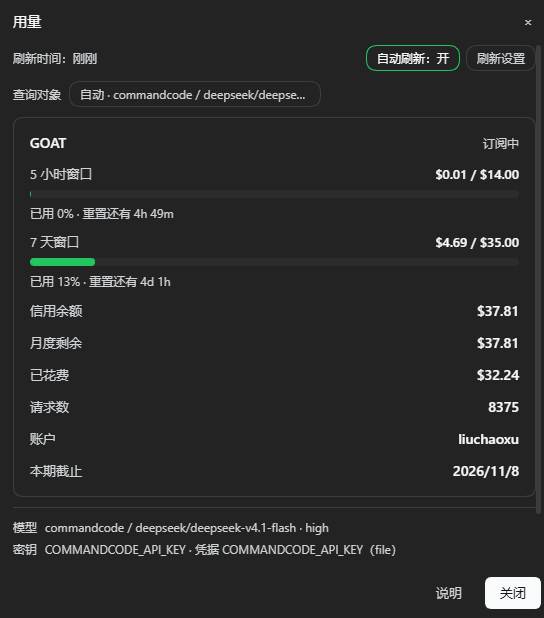

# dsh-model-usage

Provider-account usage for [DeepSeek Harness](https://github.com/deepseek-ai/deepseek-harness)
sessions. The plugin adds a **Usage** (`用量`) entry to the session header and reports the quota
windows, balance and request counters of the provider account behind the model the conversation is
using.

Queries run in the host process with the provider's own credential reference. The browser receives
normalized values and the credential reference name; credential values never leave the host.



*Usage panel for a Command Code subscription (Chinese UI): five-hour and weekly quota windows,
credit balance, spend, request count, and the model and credential reference used for the query.*

*Command Code 订阅的用量面板：5 小时 / 7 天窗口、信用余额、已花费、请求数，以及本次查询使用的
模型与凭据引用。*

Published on npm as [`dsh-model-usage`](https://www.npmjs.com/package/dsh-model-usage).

## Features

- **Session model.** The query target comes from the session's `modelSelection` projection, so the
  panel follows model changes in the conversation.
- **Manual target.** Any routable provider model can be queried from the panel without changing the
  model the conversation runs on.
- **Background refresh.** The mounted component refreshes on an interval, including while the panel
  is closed.
- **Provider directory.** The deployment's provider routes are listed with their usage adapter,
  credential reference name and configuration state. Values are never read out.

## Requirements

- DeepSeek Harness `>=0.2.1-rc.2` with the Web surface
- Node.js `>=18`
- No runtime dependencies. The browser half requires only the platform `react` module.

## Installation

```sh
dsh plugin --profile <profile> add dsh-model-usage
```

From an agent session, the bundle can also be installed by name with `install_bundle` (target
`dsh-model-usage`, or the repository path for a local checkout). Both paths install the package into
the profile, mount the bundle patch row `model-usage` and enable the bundle.

With profile HMR enabled, host-side changes apply immediately; otherwise restart the host
(`dsh web` or the desktop application). The browser half is served by `dsh-client-modules` and is
picked up by reloading the page.

## Usage sources

| Provider / base URL | Source | Reported values |
| --- | --- | --- |
| `commandcode`, `*.commandcode.ai` | `GET /alpha/whoami?limits=1`, `/alpha/billing/credits`, `/alpha/billing/subscriptions`, `/alpha/usage/summary?since=` | Plan, five-hour and weekly windows, credit balance, spend, request count |
| `deepseek-official`, `deepseek`, `*.deepseek.com` | `GET https://api.deepseek.com/user/balance` | Balance per currency |
| `deepseek-account` | `ctx.deepseekAccount.getBalance()` | Wallet balances of the signed-in account, without an API key |
| `opencode-go`, `opencode.ai/zen/go` | `GET {origin}/zen/go/v1/usage` | Five-hour, weekly and monthly allowances per model |
| `openrouter`, `*.openrouter.ai` | `GET /api/v1/key`; `GET /api/v1/credits` when the key has no limit of its own | Used, limit, remaining and the account credit pool |
| `moonshotai`, `moonshotai-cn`, `kimi-coding`, `*.moonshot.cn`, `*.moonshot.ai` | `GET /v1/users/me/balance` | Available, cash and voucher balance |
| `siliconflow`, `*.siliconflow.cn`, `*.siliconflow.com` | `GET /v1/user/info` | Total, charged and granted balance |
| Other OpenAI-compatible routes with a `baseURL` | cc-switch New API convention: `GET {origin}/api/user/self` | Quota converted to USD; best effort |

The OpenCode Go endpoint is not publicly documented. Fields are normalized by their common names;
payloads that cannot be recognized remain available under **Raw response**. OpenCode Zen
(pay-as-you-go) has no usage endpoint (`/zen/v1/usage`, `/me` and `/credits` return 404), so
`opencode` routes report that usage queries are not supported. Routes without a `baseURL` and
without a known provider return an explicit error instead of an inferred endpoint.

Adding an adapter requires selecting the route in `kindOf()` and returning normalized data from a
`queryXxx()` function: `{ rows }` for label/value lines or `{ windows, models }` for meters. The
client renders both shapes with the generic card.

## Query target and credentials

1. The browser reads `next ?? lastUsed` from the session's `modelSelection` projection and sends
   `{ provider, model, reasoningEffort, sessionId }` to `POST /model-usage/balance`.
2. If the request carries no target, the host falls back to the session projection of the process
   and then to the deployment default (`agentDefaultModel.currentSelection()`).
3. The provider's settings location is resolved through `llm.listConfigurableProviders()` and read
   with `settings.describe()`, which supplies `apiKeyEnv`, `baseURL`, `api` and custom headers.
4. `ctx.credentials.resolve(apiKeyEnv)` returns the key in use. An unconfigured reference falls back
   to the environment variable of the same name; Command Code also falls back to
   `~/.commandcode/auth.json`. Keys are resolved per request, so a key added in Settings → Models is
   used by the next query without a restart.
5. The usage adapter is selected from the provider or base URL.

Providers without `apiKeyEnv` use the convention `${PROVIDER}_API_KEY`; `deepseek-official` uses
`DEEPSEEK_API_KEY`.

The panel header shows the active target. `Auto · <provider> / <model>` follows the conversation.
Selecting it opens the model picker with `Auto (follow the conversation)` and the routable provider
models from `sessionController.modelCatalog()`, annotated with their adapter or with
`usage query not supported`. A manual target changes only the panel's query, not the conversation
model, and the credential reference follows the selected provider. The choice is stored in
`dsh-model-usage:model` and can be reset to auto from the panel.

Usage is account-level: models behind the same key share the same quota, so selecting a target
selects the account to query. The panel lists the model and credential reference used.

## Refresh and status

The component queries when it mounts and when the session model changes. With auto-refresh enabled
it continues on an interval whether or not the panel is open.

- The status line reports freshness: `Updated just now`, `Updated 12 min ago`,
  `Refreshing… · showing data from 3 min ago`, or `Not refreshed yet`. A hint is appended when the
  data is older than the interval.
- Auto refresh is toggled from the status line or the refresh settings dialog.
- The interval accepts 1, 5, 15, 30 or 60 minutes, or any value from 1 to 1440. Defaults are enabled
  and five minutes. The policy is stored in `dsh-model-usage:refresh`.
- Opening the panel with data inside the interval does not send a request; **Refresh** forces one.
- A failed query keeps the previous data and appends `Last refresh failed: …`. The full error state
  with **Retry** appears only when no query has succeeded.
- The host applies a 30-second timeout per usage call; the browser applies a 45-second outer timeout.

## Security

- Credential values are read in the host process and are never returned to the browser or written to
  logs. Responses contain normalized values plus the reference name and source.
- All three routes check the composition's browser trust decision (Host/Origin) through the
  `connection` service and answer 401/403 when it is denied.
- The plugin uploads nothing. Usage requests go from the host to the provider API.

## Compatibility

- The bundle declares `dsh.bundle.patch`, `dsh.client` (`platform: web`), `manifestVersion: 1`,
  `engines.dsh` and `engines.node`.
- `locale/zh.json` and `locale/en.json` provide the plugin title and description, and `icon.svg` is
  the icon; both are exported and included in the package.
- The browser half registers `conversation.session.header.utilities`, requires only `react`, and
  addresses the plugin routes with document-relative URLs, so a GUI mounted under a subpath works.
- The host half uses Node built-ins only. `webServer` is the single hard dependency; `connection`,
  `credentials`, `llm`, `settings`, `sessions`, `sessionProjections`, `sessionController`,
  `agentDefaultModel` and `deepseekAccount` are resolved through `ctx.get()` when used, so the
  plugin mounts where those services are optional or activate later.
- Without a locale service, both dictionaries fall back to the Chinese source text.

## Development

```sh
npm run verify   # check + smoke, also runs from prepublishOnly
npm test         # alias for the same suite
```

`scripts/check.mjs` validates the manifest and npm metadata, shipped files, README images, loader
id, baseline module requests, dictionaries, host imports and route registration.
`scripts/smoke.mjs` mounts the host half on a stub context and exercises the three routes, the error
envelopes and the trust fence.

Release:

1. Set `version` according to Semantic Versioning (visible behavior: minor; fixes: patch).
2. Update `CHANGELOG.md`.
3. Run `npm run verify`, then `npm publish`.

Accounts with 2FA publish with `npm publish --otp=<code>`, or authenticate with a Granular Access
Token that allows bypassing 2FA. Keep tokens in the user-level `~/.npmrc`, outside the repository.

## License

MIT. DeepSeek Harness is also MIT-licensed. This is an independent community plugin, not affiliated
with or endorsed by DeepSeek.

## 中文

本插件为 [DeepSeek Harness](https://github.com/deepseek-ai/deepseek-harness) 会话提供
当前模型对应供应商账户的用量。它在会话头部增加「用量」入口，显示套餐窗口、余额与请求数；
查询在 host 进程内使用该供应商自己的凭据引用完成，浏览器只收到归一化数值与凭据引用名。

### 功能

- **跟随会话模型**：查询对象取自会话的 `modelSelection` 投影，对话中切换模型时面板随之切换。
- **手动查询对象**：可查询任意可路由的供应商模型，不改变当前对话使用的模型。
- **后台刷新**：已挂载的组件按间隔刷新，弹窗关闭时同样生效。
- **供应商目录**：列出本部署声明的供应商路由、用量适配器、凭据引用名与配置状态，不读取凭据值。

### 环境要求

- DeepSeek Harness `>=0.2.1-rc.2`，并启用 Web 界面
- Node.js `>=18`
- 无运行时依赖；浏览器半只使用平台提供的 `react` 模块

### 安装

```sh
dsh plugin --profile <profile> add dsh-model-usage
```

也可在 agent 会话中通过 `install_bundle` 安装（target 为 `dsh-model-usage`，本地开发时传仓库路径）。
两种方式都会把包装入 profile、挂载 bundle patch 的 `model-usage` 行并启用。

启用 profile HMR 时 host 侧改动立即生效；否则重启宿主（`dsh web` 或桌面版）。浏览器半由
`dsh-client-modules` 提供，刷新页面后生效。

### 用量来源

| provider / baseURL | 来源 | 返回值 |
| --- | --- | --- |
| `commandcode`、`*.commandcode.ai` | `GET /alpha/whoami?limits=1`、`/alpha/billing/credits`、`/alpha/billing/subscriptions`、`/alpha/usage/summary?since=` | 套餐、5 小时 / 7 天窗口、信用余额、已花费、请求数 |
| `deepseek-official`、`deepseek`、`*.deepseek.com` | `GET https://api.deepseek.com/user/balance` | 按币种的余额 |
| `deepseek-account` | `ctx.deepseekAccount.getBalance()` | 已登录账户的钱包余额（不涉及 API Key） |
| `opencode-go`、`opencode.ai/zen/go` | `GET {origin}/zen/go/v1/usage` | 按模型的 5 小时 / 周 / 月额度 |
| `openrouter`、`*.openrouter.ai` | `GET /api/v1/key`；key 无独立额度时再查 `GET /api/v1/credits` | 已用、额度、剩余与账户额度池 |
| `moonshotai`、`moonshotai-cn`、`kimi-coding`、`*.moonshot.cn`、`*.moonshot.ai` | `GET /v1/users/me/balance` | 可用余额、现金余额、代金券 |
| `siliconflow`、`*.siliconflow.cn`、`*.siliconflow.com` | `GET /v1/user/info` | 总余额、充值余额、赠送余额 |
| 其它带 `baseURL` 的 OpenAI 兼容路由 | cc-switch New API 约定：`GET {origin}/api/user/self` | 按约定换算为 USD，尽力而为 |

OpenCode Go 的端点未公开文档化，字段按常见命名归一化；无法识别的返回保留在「原始返回」中。
OpenCode Zen（按量付费）没有用量接口（`/zen/v1/usage`、`/me`、`/credits` 均为 404），
`opencode` 路由会明确提示不支持用量查询。既无 `baseURL`、也非已知供应商的路由返回明确错误，
不会推断接口。

新增适配器只需在 `kindOf()` 中认领路由，并由 `queryXxx()` 返回归一化数据：`{ rows }` 渲染为
标签值行，`{ windows, models }` 渲染为用量条，客户端统一用通用卡片展示。

### 查询对象与凭据

1. 浏览器读取会话 `modelSelection` 投影的 `next ?? lastUsed`，向 `POST /model-usage/balance`
   发送 `{ provider, model, reasoningEffort, sessionId }`。
2. 请求未携带查询对象时，host 依次回退到本进程的会话投影与部署默认模型
   （`agentDefaultModel.currentSelection()`）。
3. host 通过 `llm.listConfigurableProviders()` 取得该 provider 的配置位置，并用
   `settings.describe()` 读取实时配置，得到 `apiKeyEnv`、`baseURL`、`api` 与自定义 headers。
4. `ctx.credentials.resolve(apiKeyEnv)` 取得当前使用的 key。引用未配置时回退到同名环境变量；
   Command Code 还会回退到 `~/.commandcode/auth.json`。解析在每次查询时进行，因此
   「设置 → 模型」中新填的 key 无需重启即可用于下一次查询。
5. 按 provider 或 baseURL 选择用量适配器。

未声明 `apiKeyEnv` 的 provider 按 `${PROVIDER}_API_KEY` 约定推导引用名，`deepseek-official`
使用 `DEEPSEEK_API_KEY`。

面板顶部显示当前查询对象。`自动 · <provider> / <model>` 跟随对话；点击后可在模型选择器中选择
`自动（跟随当前对话）`，或选择 `sessionController.modelCatalog()` 中任意可路由模型（标注其适配器
或「不支持用量查询」）。手动选择只改变面板的查询对象，不改变对话模型，凭据引用随所选供应商切换；
选择保存在 `dsh-model-usage:model`，可在面板中改回自动。

用量是账户级数据：同一把 key 下的模型共享同一份额度，因此切换查询对象即切换要查询的账户。
面板底部列出本次查询使用的模型与凭据引用。

### 刷新与状态

组件在挂载时与会话模型变化时查询。开启自动刷新后，无论弹窗是否打开，都会按间隔继续查询。

- 状态行显示数据新鲜度：`刷新时间：刚刚`、`刷新时间：12 分钟前`、
  `刷新中… · 当前显示 3 分钟前数据`、`尚未刷新`；数据超过刷新间隔时会追加提示。
- 自动刷新可在状态行或刷新设置中开关。
- 刷新间隔支持 1 / 5 / 15 / 30 / 60 分钟，也可填写 1–1440 之间的任意分钟数；默认开启、间隔
  5 分钟。策略保存在 `dsh-model-usage:refresh`。
- 数据仍在间隔内时打开面板不会发起请求；「刷新」按钮可强制查询。
- 查询失败时保留上次数据并追加 `上次刷新失败：…`；仅在从未成功时显示整屏错误与「重试」。
- host 侧单次用量请求超时 30 秒，浏览器侧另有 45 秒外层超时。

### 安全

- 凭据值只在 host 进程内读取，不返回浏览器，也不写入日志；响应仅包含归一化数值、引用名与来源。
- 三条路由在应答前通过 `connection` 服务校验浏览器信任（Host/Origin），未通过时返回 401/403。
- 插件不上传任何数据，用量请求由 host 直接发往供应商接口。

### 兼容性

- bundle 声明 `dsh.bundle.patch`、`dsh.client`（`platform: web`）、`manifestVersion: 1`、
  `engines.dsh` 与 `engines.node`。
- `locale/zh.json`、`locale/en.json` 提供插件标题与描述，`icon.svg` 为图标；两者都已导出并包含在包内。
- 浏览器半注册 `conversation.session.header.utilities`，只依赖 `react`，并使用文档相对路径访问
  插件路由，因此 GUI 挂在子目录下同样可用。
- host 半只使用 Node 内置模块。`webServer` 是唯一硬依赖；`connection`、`credentials`、`llm`、
  `settings`、`sessions`、`sessionProjections`、`sessionController`、`agentDefaultModel`、
  `deepseekAccount` 均按需通过 `ctx.get()` 获取，服务缺失或稍后激活时插件仍可挂载。
- 没有 locale 服务时，词典回退为中文原文。

### 开发

```sh
npm run verify   # check + smoke，prepublishOnly 同样执行
npm test         # 同一套检查的别名
```

`scripts/check.mjs` 校验清单与 npm 元数据、随包文件、README 图片、loader id、基线模块、
词典、host 导入与路由注册；`scripts/smoke.mjs` 在桩 ctx 上挂载 host 半，覆盖三条路由、
错误响应与信任栅栏。

发布流程：

1. 按语义化版本更新 `version`（可见行为变化为 minor，修复为 patch）。
2. 更新 `CHANGELOG.md`。
3. 运行 `npm run verify`，然后执行 `npm publish`。

启用 2FA 的账号可用 `npm publish --otp=<验证码>` 发布，或使用允许绕过 2FA 的 Granular Access
Token 认证。令牌只保存在用户级 `~/.npmrc`，不要提交到仓库。

### 许可

MIT。DeepSeek Harness 同样以 MIT 许可发布。本项目为独立社区插件，与深度求索公司无隶属或背书关系。
